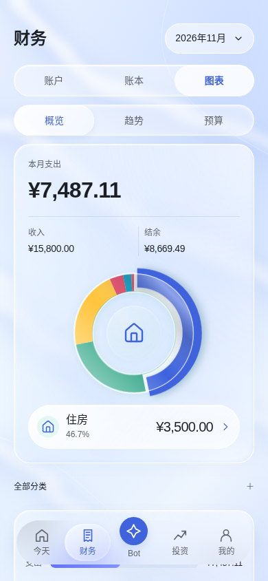
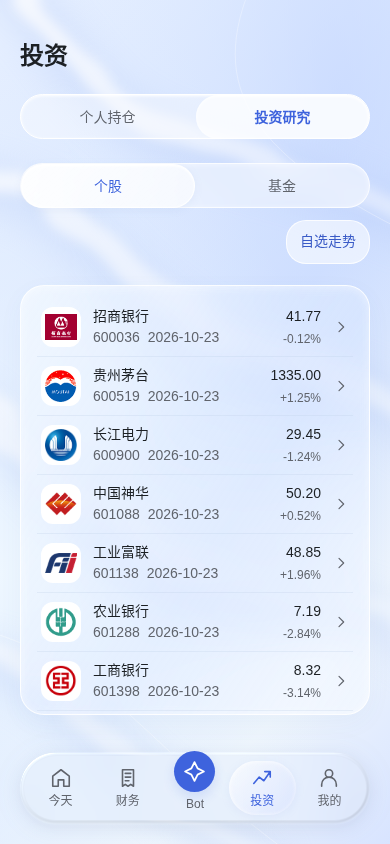

<table><tr><td width="23%" align="center"></td><td width="77%"></td></tr></table>

<p align="center">
  
  
  
  
  
</p>


## 打开离线演示

**[直接打开 GPT Site 离线演示](https://finpilot-judge-demo.pgr17398956318.chatgpt.site/?offline=1&app=1#/finance)**，无需安装或模型 Key。这里的“离线”指使用浏览器内预置数据、不调用模型；网页仍由 GPT Site 托管。

## FinPilot能做什么

- **安全换你安心** 自动识别交易和外部信息中的风险，根据风险程度选择确认、身份验证或暂停操作，让每一步资金往来都有保障。
- **有事主动提醒。** 关注账单、订阅和日程等重要事项，在合适的时间主动提醒，并在涉及操作时征得用户同意。
- **一句话安排多件事。** 理解生活中的复杂需求，协调多个步骤和服务，逐步完成安排，让用户随时了解进度并决定是否继续。
- **把模糊想法问清楚。** 通过简单对话了解用户的目标和偏好，结合财务情况，提供更贴合需求的预算、储蓄与理财建议。
- **文字与语音接续。** 支持文字和语音交互，用自然的对话方式提供回答、图表和操作卡片；即使没有连接语音服务，也能正常使用文字功能。


<table>
  <tr>
    <td align="center"><br>今天：工资到账</td>
    <td align="center"><br>Bot：按任务授权</td>
    <td align="center"><br>财务：分类图表</td>
    <td align="center"><br>投资：个股研究</td>
  </tr>
</table>

## 在线使用与开发

在线演示可通过上方入口打开。启动和模型连接见 [运行指南](RUNNING.md)。支持 Micu 与 MiniMax 官方对话，模型名可编辑；MiniMax 语音独立连接。凭据只留在服务内存，由用户自行填写。

```text
backend/          对话协议、提供方连接、会话与后端适配
baseline_backend/ 账户、持仓和行情数据模块
web/              App、桌面展示与前端资源
demo/             合成业务数据
config/           配置示例
tests/            自动化检查
tools/            启动验证与发布检查工具
docs/             演示流程和使用说明
server.py         本地启动入口
```


